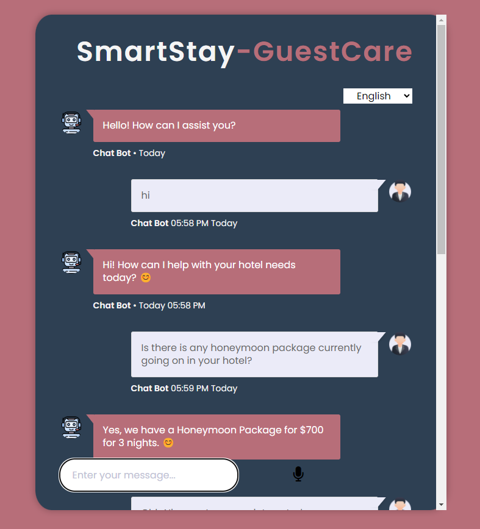
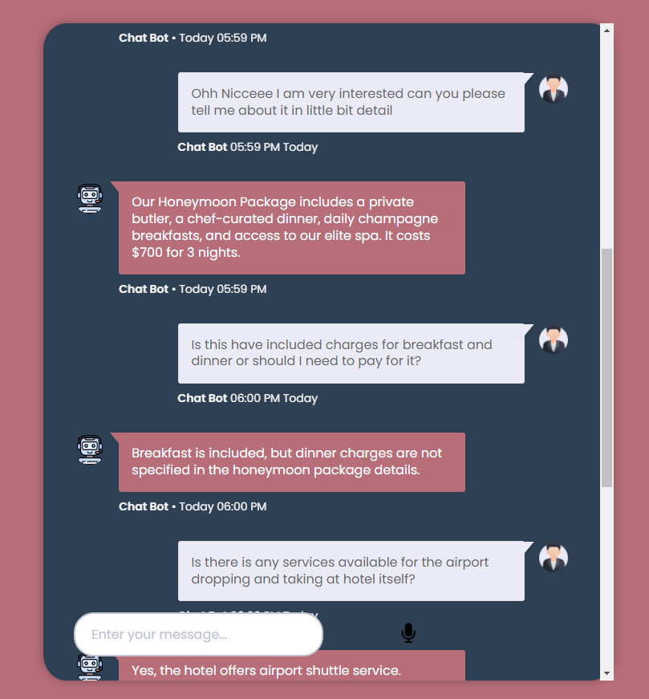

# SmartStay-GuestCare
SmartStay-GuestCare is an interactive hotel chatbot designed to provide guests with real-time information about hotel facilities, rooms, pricing, and services.




## Steps to Run it
### 1. Cloning the Repository
```bash

git clone https://github.com/MANMEET75/SmartStay-GuestCare.git
```
### 2. Creating the virtual environment using anaconda
```bash
conda create -p venv python=3.11 -y
```

### 3. Activate the virtual environment
```bash
conda activate venv/
```

### 4. Install the Requirements
```bash
pip install -r requirements.txt
```
### 5. Run the following docker command in your command prompt
```bash
docker-compose up
```
### 6. Generate the Embeddings
```bash
python ingest.py
```
### 7. Run the FastAPI application
```bash
uvicorn main:app --reload --port 8080
``` 
## Steps to Change the database name
```bash
docker-compose down
```
### Change the Database name from docker-compose.yml file
```bash
docker-compose up
```

over here we reranker as well

Enjoy Coding!